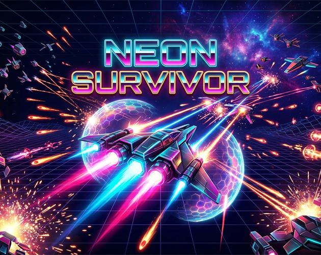
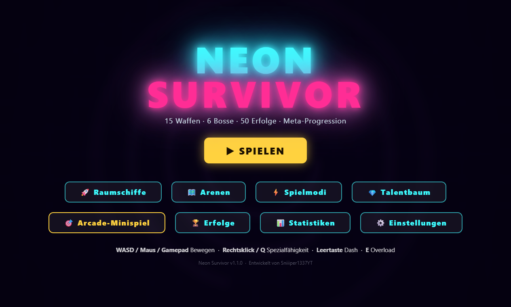
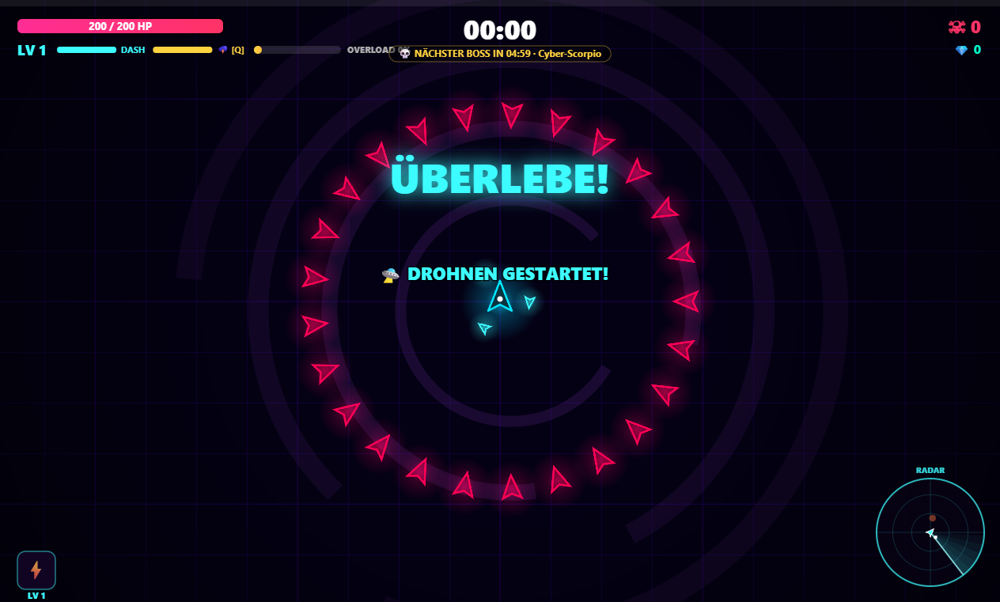
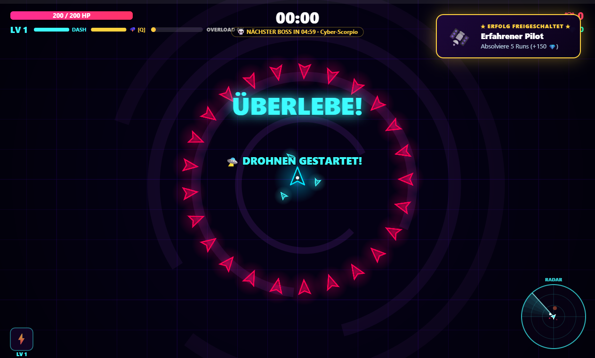
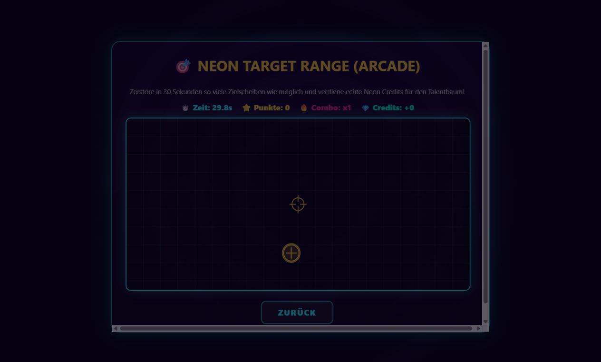

# 🚀 Neon Survivor

  

Ein rasanter, neon-ästhetischer Sci-Fi Bullet-Heaven / Rogue-lite Survival Shooter. Kämpfe gegen endlose Horden feindlicher Drohnen, sammle Neon-Gems, fusioniere tödliche Waffen-Evolutionen und besiege mächtige Wächter-Bosse.

---

## 📸 Screenshots

| Arcade Target Range Minispiel | Gameplay-Action & Drohnen |
| :---: | :---: |
|  |  |

| Epischer Wächter-Bosskampf | Talentbaum (Permanente Meta-Progression) |
| :---: | :---: |
|  |  |

---

## 🎮 Highlights & Features

- **⚡ 8 Einzigartige Sekundärfähigkeiten (Secondary Abilities):**
  - Jedes Raumschiff besitzt eine eigene aktive Spezialfähigkeit auf Cooldown (aktivierbar via Rechtsklick / Taste Q):
    - **Apex-1:** *Drohnengeschwader* (Entsendet 3 autonome Abfangjäger)
    - **Valkyrie:** *Warp-Sprung* (320px Vorwärtssprung mit kinetischer Schockwelle & I-Frames)
    - **Colossus:** *Aegis-Barriere* (4.5s Hex-Schutzschild, blockt Projektile & rammt Mobs)
    - **Tesla-9:** *Gewitter-Entladung* (10-fache Kettenblitz-Serie mit 2.2s Feindlähmung)
    - **Specter:** *Phasen-Tarnung* (3.5s Unantastbarkeit, +60% Tempo & schädigende Schattenpfade)
    - **Havoc-X:** *Cluster-Sperrfeuer* (Fächerförmige Streubomben-Raketen)
    - **Nova-Core:** *Fusions-Schockwelle* (Löscht alle Feindgeschosse, stößt ab & lädt +15% Overload)
    - **Chronos-X:** *Chronostase* (Friert alle Feinde & Kugeln für 3.5s komplett ein)
- **🌊 Endlos-Modus mit Wellen-System:**
  - 60-Sekunden Wellenfortschritt mit Event-Surges, Wellen-Abschluss-Boni (+Credits, Reparatur-Heilung, Gem-Cluster), Boss-Duellen und Karriere-Highscore-Tracking (`Beste Welle`).
- **🎯 Neuer Spielmodus: Dimensions-Rallye:**
  - **Spielmodus "Dimensions-Rallye (Minispiel)":** Ein intensiver 3-Minuten-Arcade-Parcours! Sammle leuchtende Dimensions-Kerne, die Feinde im Umkreis zerschmettern, lade deinen Neon Overload im Rekordtempo auf und sichere dir bei Überleben den gigantischen Neon-Jackpot (+Credits basierend auf gesammelten Kernen).
  - **In-Run Dimensions-Portale:** Periodische Portal-Events mit 25s Kerne-Sammel-Herausforderung für epische +350 Credits & Hypercharge.
- **🗺️ Bessere Maps, Map-spezifische Musik & Menü-Synthwave:**
  - Chillige, atmosphärische Cyberpunk-Synthwave-Musik im Hauptmenü mit automatischem Start beim ersten Klick.
  - Jede der 6 Arenen besitzt individuelle, animierte Grafik-Layer (Parallax-Sternenfelder, Matrix-Code-Rain, Schwarzes-Loch-Vortex, hexagonale Magma-Platten, Asteroidenschatten, Glitch-Scanlines).
  - Voller dynamischer Web-Audio-Synthesizer mit map-spezifischen BPM, Akkordfolgen, Basslines und Synthesizer-Leads.
- **15 Waffen & 15 mächtige Waffen-Evolutionen:**
  - Hyper-Gatling, Singularitäts-Klingen, Supernova-Kollaps, Götterdämmerung (Thor's Arc), Armageddon-Batterie, Photonen-Obliterator, Event-Horizon, Aegis-Schwarm, Thermonukleare Minen, Höllensturm-Flak, Absoluter Nullpunkt, Plasma-Reaper, Höllenfeuer-Drache, Sternen-Sense und Chronos-Matrix.
- **10 Passive Upgrades & 50 Erfolge:**
  - Kraft, Überladung, Turbo, Vitalität, Magnet, Panzerung, Nanobots, Präzision, Splitter und Neon-Reaktor.
- **17 Gegnertypen & 6 Epische Wächter-Bosse:**
  - Scorpio, Leviathan, Titan, Vortex Eye, Chronos und Arch-Sentinel mit Offscreen-Zielerfassung, Näherungswarnern und Jagd-Phasen.
- **🛠️ Vollständiges Test-Labor (Sandbox-Modus):**
  - Zugriff im Spiel jederzeit über **`TAB`** oder **`F2`**.
- **👾 Discord Rich Presence Integration:**
  - Automatische Live-Statusanzeige in Discord.

---

## 🕹️ Steuerung

| Aktion | Tastatur / Maus | Gamepad |
| :--- | :--- | :--- |
| **Bewegen** | `Maus` (Flüssiges Steuern nach Mauszeiger) | Linker Stick |
| **Dash (Ausweichrolle)** | `Leertaste` / `Linksklick` / `Shift` | `A` (Süd-Taste) / `LT` |
| **Spezialfähigkeit (Sekundär)** | `Q` / `Rechtsklick` | `X` (West-Taste) / `LB` |
| **Neon Overload (Ult)** | `E` / Mausrad-Klick | `Y` (Nord-Taste) / `RT` / `RB` |
| **Upgrade wählen (Levelaufstieg)** | `1`, `2`, `3` / Mausklick | D-Pad / `A` |
| **Test-Labor (Sandbox)** | `TAB` / `F2` | - |
| **Pause** | `Escape` / `P` | `Start` |

---

## 🚀 Spiel starten

1. Starte direkt die `Neon Survivor.exe`.
2. Alternativ kann die `data/neon_survivor.html` in jedem modernen Webbrowser (Chrome, Edge, Firefox) geöffnet werden.

---

## 📜 Lizenz & Urheberrecht / License

Copyright © 2026 **Sniiiper1337YT**. Alle Rechte vorbehalten (All rights reserved).

Dieses Spiel sowie sämtliche enthaltene Komponenten (Quellcode, Grafiken, Sounds, Musik) sind urheberrechtlich geschützt. Ohne ausdrückliche schriftliche Genehmigung ist das Kopieren, Verändern, Weiterverbreiten oder die kommerzielle Nutzung untersagt. Weitere Details findest du in der [LICENSE](LICENSE)-Datei.
